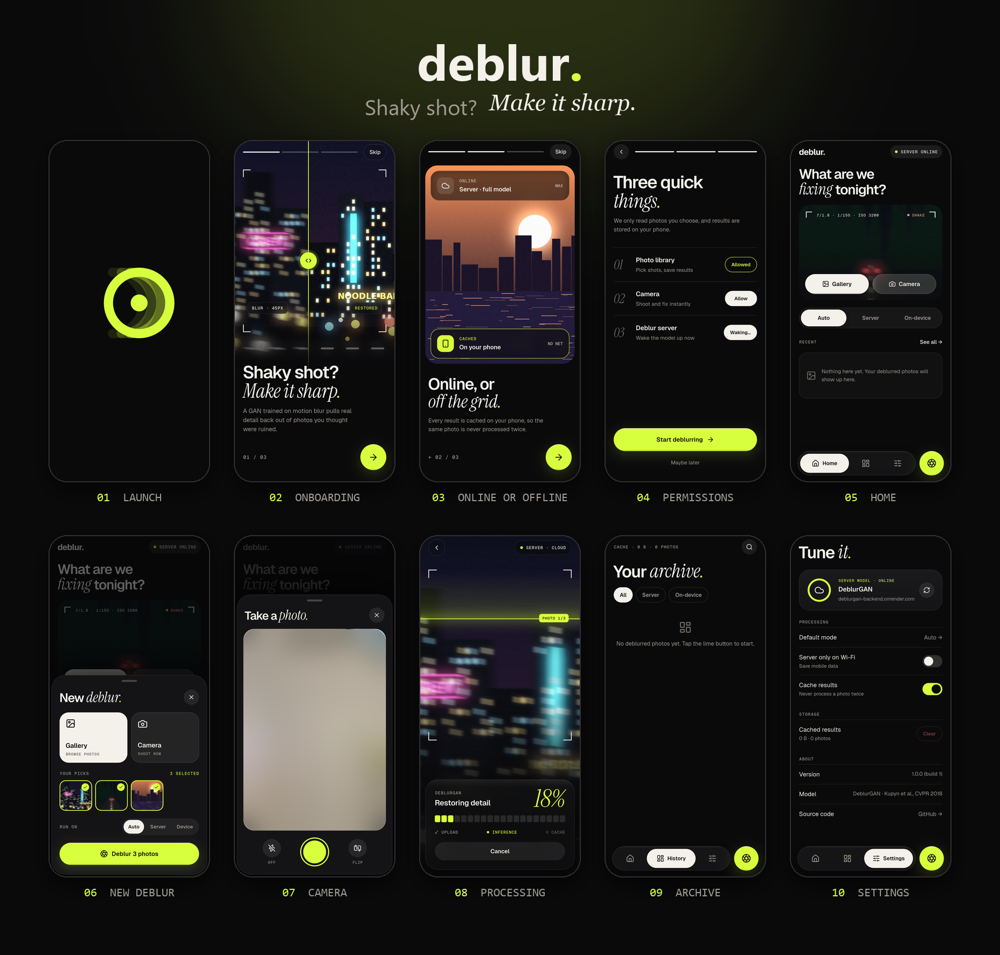
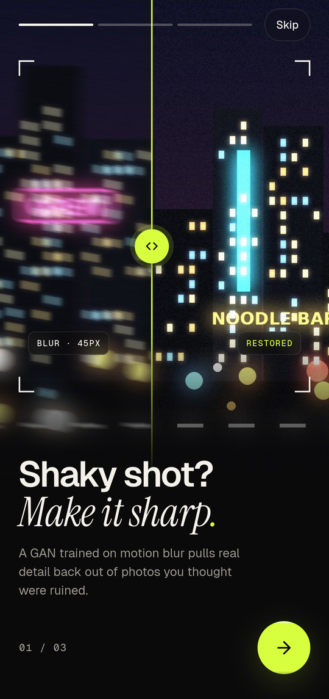
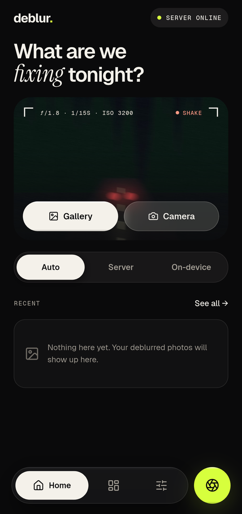
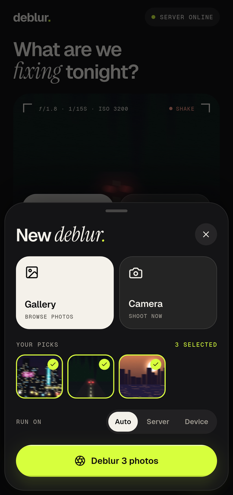
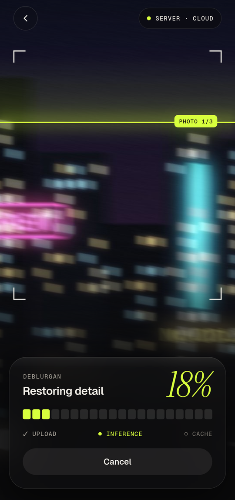
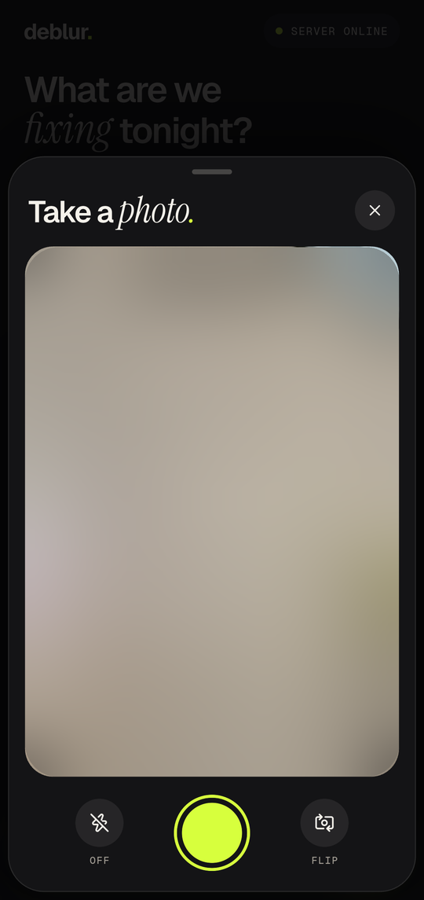
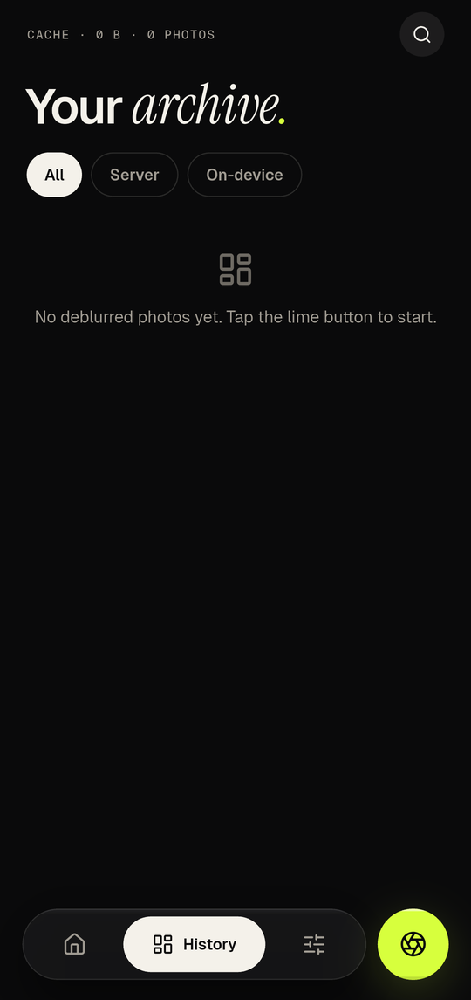
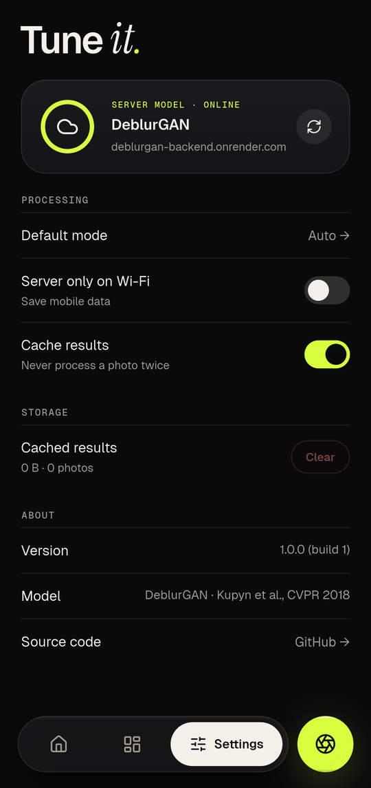
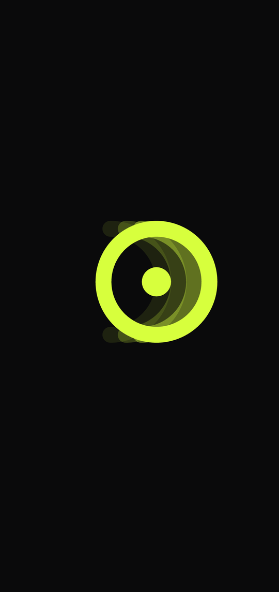
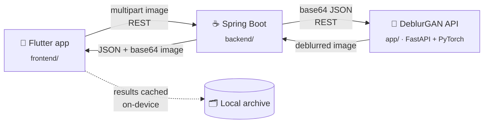

<div align="center">

# deblur.

### Shaky shot? *Make it sharp.*

**AI-Powered Image Deblurring App using GAN (DeblurGAN)**

Restore motion-blurred photos with a DeblurGAN generator, served through a
Spring Boot backend to a Flutter mobile app.


B.Tech CSE (Data Science) final-year project · Project ID `27_CS_DS_4B_13` ·
Pranveer Singh Institute of Technology

<br>



</div>

---

## ✨ Features

| | |
|---|---|
| 🎯 **One-tap deblur** | Pick from the gallery or shoot a photo and it goes straight to the model. |
| 📷 **In-app camera** | A 3/4-height camera sheet with flash, flip and retake, with no jump to a full-screen camera app. |
| 🖼️ **Batch mode** | Pick several photos in the New Deblur sheet and restore them in one go. |
| 🔍 **Drag to compare** | Full-bleed before/after slider: drag anywhere to move the divider. |
| ⚡ **Smart cache** | Results are keyed by the photo's SHA-256, so the same photo is never processed twice. |
| 🗂️ **Archive** | Every result is stored on the phone, with filters, search and long-press to delete. |
| 💾 **Save & share** | Save the sharp version to your gallery or share it anywhere. |
| 📶 **Data saver** | Optional "Server only on Wi-Fi" mode. |
| 🟢 **Live server status** | Shows whether the free-tier backend is online, waking up or offline. |
| 🌑 **Designed dark UI** | Glass surfaces, viewfinder brackets, a lime scan-line animation and a Lottie launch animation. |

## 📱 Screens

| Onboarding | Home | New deblur | Processing |
|:-:|:-:|:-:|:-:|
|  |  |  |  |

| Camera | Archive | Settings | Launch |
|:-:|:-:|:-:|:-:|
|  |  |  |  |

## 🏗️ Architecture



The app never talks to the model directly. The Spring Boot backend validates
uploads and orchestrates the call to the deployed inference service, which
mirrors the client-server architecture in the project synopsis (Fig. 1).

| Layer | Stack | Live at |
|---|---|---|
| [`frontend/`](frontend/README.md) | Flutter · Provider · Dio · Lottie · camera | Android / iOS app |
| [`backend/`](backend/README.md) | Spring Boot 3 · WebClient · Java 17 | `https://deblurgan-backend.onrender.com` |
| [`app/`](app/README.md) | Python · PyTorch · FastAPI · DeblurGAN generator | `https://deblurgan-api.onrender.com` |

Each folder is self-contained with its own README, dependencies and run
instructions. The contract between them is in
[`docs/API_CONTRACT.md`](docs/API_CONTRACT.md). Read that first if you're
integrating two parts.

## 🚀 Getting started

**1. Model service.** `app/` is already deployed at
`https://deblurgan-api.onrender.com`, so there's nothing to run locally
unless you want your own copy (see [`app/README.md`](app/README.md)).

**2. Backend**

```bash
cd backend
./mvnw spring-boot:run        # starts on :8080 and calls the deployed model API
```

**3. App**

```bash
cd frontend
flutter pub get
flutter run                   # uses the deployed backend by default

# or point it at a local backend:
flutter run --dart-define=API_BASE_URL=http://10.0.2.2:8080   # Android emulator
```

> ⏳ Both services run on Render's free tier and sleep when idle. The first
> request after a while can take about a minute while they wake up, and the
> app tells you when that's happening.

## 🧭 How a deblur works

1. **Pick:** gallery (one or many) or the in-app camera.
2. **Cache check:** the photo's SHA-256 is looked up in the on-device
   archive. If it's there, the result is served instantly (⚡ CACHED).
3. **Upload → inference:** the photo is sent to the backend, which forwards
   it to the DeblurGAN service. A lime scan line sweeps the photo while it
   works.
4. **Reveal:** a final sweep uncovers the sharp result, then the
   before/after compare view opens.
5. **Keep:** the original and the result are saved to the archive. Save to
   gallery or share from there.

## 🗺️ Roadmap

- [ ] On-device model (the **On-device** mode in the UI is ready; until it
      ships, every mode runs on the server)
- [ ] Automatic detection of blurry shots in the gallery

## 📚 Reference

- O. Kupyn et al., "DeblurGAN: Blind Motion Deblurring Using Conditional
  Adversarial Networks," CVPR 2018.
- Project synopsis: *AI-Powered Image Deblurring App Using GAN (DeblurGAN)*.
