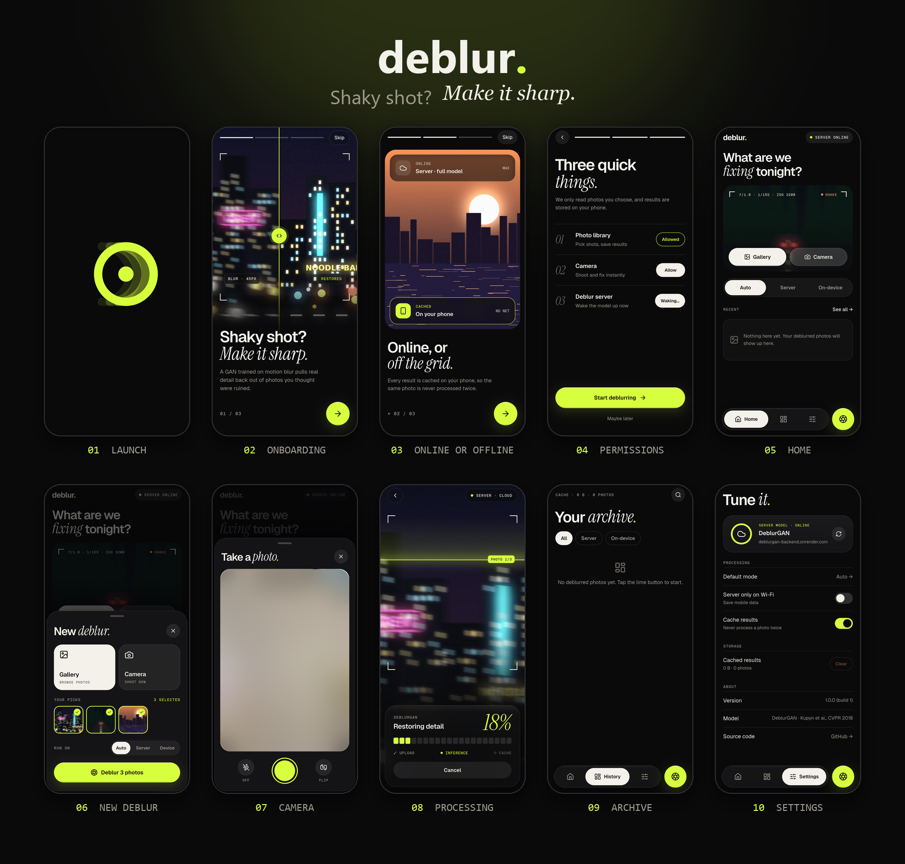

# frontend/ — Deblur (Flutter app)

Mobile client for the DeblurGAN final-year project. Pick or shoot a blurry
photo, send it to the Spring Boot backend (`../backend/`), and compare the
original with the AI-deblurred result in a drag-to-compare view.

The app never talks to the Python ML service directly. It only calls the
backend's `/api/v1/*` routes. See [`../docs/API_CONTRACT.md`](../docs/API_CONTRACT.md)
for the contract between all three parts of the system.



## Screens & flow

```
Splash (Lottie) → Onboarding 1 → 2 → 3 → Home
Home ─ Gallery / Camera ───────────────→ Processing → Result
Home ─ lime button → New Deblur sheet ─→ Processing → Result
Home ↔ History ↔ Settings   (floating glass nav)
History tile → Result
```

| Screen | What it does |
|---|---|
| **Splash** | Lottie launch animation over a matching native splash. |
| **Onboarding** | Three-step intro; also wakes the free-tier server early. |
| **Home** | Hero card with Gallery / Camera, processing mode, recent results, live server status. |
| **New Deblur sheet** | Multi-pick from gallery or camera, choose where to run, deblur all at once. |
| **Camera sheet** | In-app camera at 3/4 height: flash, flip, retake / use photo. |
| **Processing** | Scan-line animation, upload → inference → cache steps, cancel and retry. |
| **Result** | Full-bleed before/after slider, save to gallery, share. |
| **History** | Staggered archive with filters, search, long-press to delete. |
| **Settings** | Server status, default mode, Wi-Fi-only, result cache, storage, about. |

## Project structure

```
lib/
  main.dart                      # providers, theme, splash → onboarding/home gate
  app_keys.dart                  # root navigator key
  config/api_config.dart         # backend URL (overridable with --dart-define)
  theme/app_theme.dart           # design tokens: colours, Geist / Instrument Serif type, headline
  models/                        # DeblurResult, HistoryEntry, ProcessMode
  services/                      # ApiService (Dio), HistoryService (on-device storage)
  providers/                     # deblur job, history/cache, settings, server status
  screens/                       # splash, onboarding, shell, home, sheets, processing, result, history, settings
  widgets/                       # glass/buttons/chips (ui.dart), floating nav, before/after slider
  utils/format.dart              # "2 MIN", "TODAY · 21:04", byte sizes
assets/
  images/                        # sample before/after photos (onboarding, home)
  icon/                          # app icon sources (flutter_launcher_icons)
  lottie/deblur_splash.json      # launch animation
test/widget_test.dart            # onboarding, home/nav, splash hand-off, model + formatting tests
```

## Running it

```sh
flutter pub get
flutter run                      # uses the deployed backend on Render
```

The default backend is `https://deblurgan-backend.onrender.com`, which calls
the deployed ML API, so nothing has to run locally. To use a local backend
instead (`cd ../backend && ./mvnw spring-boot:run`), override the URL at
build time:

| Running on | Command |
|---|---|
| Android emulator | `flutter run --dart-define=API_BASE_URL=http://10.0.2.2:8080` |
| Web / desktop / iOS simulator | `flutter run --dart-define=API_BASE_URL=http://localhost:8080` |
| Physical device on your Wi-Fi | `flutter run --dart-define=API_BASE_URL=http://192.168.x.x:8080` |

Debug builds allow plain-HTTP for this; release builds stay HTTPS-only.

> Render's free tier sleeps when idle, so the first request can take about a
> minute. The app shows "Waking the server" when that happens.

## Regenerating the icon and splash

```sh
dart run flutter_launcher_icons          # app icons from assets/icon/
dart run flutter_native_splash:create    # dark native launch screen
```

## Verifying the app

```sh
flutter analyze     # should report "No issues found!"
flutter test        # widget + unit tests
```

Both work without a connected device or emulator.

## Contract

See [`../docs/API_CONTRACT.md`](../docs/API_CONTRACT.md) for the exact
request/response shapes this app is built against (`success`,
`originalFilename`, `processingTimeMs`, `deblurredImageBase64`, `error`, and
multipart field `image`).
